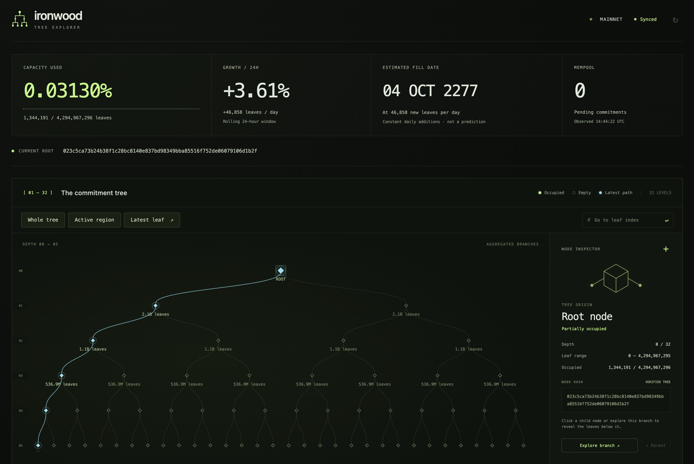

# Ironwood

A live activity monitor and commitment tree explorer for Zcash’s Ironwood shielded pool. One Rust service syncs public chain data, verifies tree roots, stores changes in SQLite, and serves a read-only API. The UI runs in the same binary or separately on Vercel.



The explorer displays the **depth-32 note commitment tree**, with capacity for 4,294,967,296 leaves and Sinsemilla hashing. It also indexes public nullifiers as a separate membership set; it does not compute a nullifier IMT root.

## Features

- The home page shows full calendar years with selectable dates, hourly peaks, and weekday rankings in the selected time zone.
- Daily pool flow medians use public net value changes from cross-pool transactions. The page also tracks pool balance, pending transactions, confirmation timing, and recent shielded block usage.
- Capacity used, rolling 24-hour growth, estimated fill date, and pending commitments.
- A draggable, zoomable tree with the latest leaf's path highlighted in blue.
- Leaf commitments, containing block timestamps in UTC, and verified subtree hashes.
- Resumable sync, provider failover, reorg recovery, and consistent historical API reads.

Rendering and storage scale with the visible region and occupied leaves. The service never allocates the entire tree. Fill dates assume constant daily additions; they are estimates.

## Run locally

Install Node.js 22.18+ and the Rust toolchain, then:

```sh
make run
```

Open **http://localhost:3000/** for pool activity or **http://localhost:3000/ironwood** for the tree. The API starts while history syncs; stop with Ctrl-C and rerun to resume. The dashboard refreshes every 10 seconds.

The public mainnet preset uses Stardust, Cake Wallet, Zec.rocks, and ZcashESP lightwalletd providers. No local Zcash node or API key is required. SQLite and the protobuf compiler are bundled. Use `make build` to install the pinned frontend dependencies and build the binary without starting it. Cargo embeds the compiled UI, and the binary runs without Node.

| Option | Default / purpose |
| --- | --- |
| `--pool-balance-url URL` | Optional Zebra RPC for block-pinned pool totals with custom lightwalletd sources. The public mainnet preset uses Tatum. |
| `--database PATH` | `data/ironwood.sqlite` |
| `--bind ADDRESS` | `127.0.0.1:3000`; use `127.0.0.1:3001` to serve on port 3001 |
| `--poll-seconds N` | `10`; increase to reduce upstream requests |
| `--lightwalletd-url URL` | Custom providers; repeat for failover, instead of `--public-rpc` |
| `--rpc-url URL` | An Ironwood-capable Zebra-compatible JSON-RPC node, instead of gRPC |
| `--once` | Catch up and sample the mempool, then exit |

Run `--help` for all options. JSON-RPC authentication uses `ZCASH_RPC_COOKIE`, or `ZCASH_RPC_USER` and `ZCASH_RPC_PASSWORD`. Environment files are not loaded automatically.

## API

```sh
curl http://localhost:3000/v1/activity
curl http://localhost:3000/v1/dashboard
curl 'http://localhost:3000/v1/leaves?from=0&limit=100'
curl http://localhost:3000/v1/tree/nodes/32/0
curl http://localhost:3000/v1/mempool
```

The API also exposes block history, nullifier membership, provider status, and health checks. Pin reads with `at=BLOCK_HASH` for a consistent tree snapshot. Tree level `0` is a leaf; level `32` is the root. Mempool values have no confirmed leaf positions.

See the [architecture and API reference](docs/architecture.md) for routes, pagination, encodings, verification, and reorg behavior.

## Deployment

**Single VPS:** run the Rust binary with SQLite on persistent local disk behind an HTTPS reverse proxy. The same process can serve the UI. Start with 1 vCPU, 1 GiB RAM, and 25 GiB SSD for a small installation; build the release binary off the VPS and monitor actual resource use.

**Vercel UI + VPS API:** import this repository into Vercel with the repository root as the project root. The UI can deploy before the backend is ready and shows a standby view. Set `IRONWOOD_API_ORIGIN` to the Rust API's public HTTPS origin, such as `https://api.example.com`, and redeploy to enable live data. The indexer and SQLite stay on the VPS.

See [deployment instructions](docs/deployment.md) for Vercel settings, a local build check, and storage/backups.

## Development

```sh
npm run typecheck
npm test
npm run build:vercel
cargo fmt --check
cargo clippy --all-targets --locked -- -D warnings
cargo test --all-targets --locked
```

Application code is TypeScript and Rust. HTML, CSS, images, SQL, and protobuf definitions remain in their native formats. Browser JavaScript is generated, never maintained or committed. The UI has no runtime npm dependencies; TypeScript and Node types are build dependencies pinned in `package-lock.json`.

`npm run build:web` emits the standalone UI to `dist/web/`. Cargo builds it into its own build directory, and Vercel packages it into `.vercel/output/`. These outputs, `node_modules/`, databases, and `.env` files are ignored. Scripts do not load environment files automatically; configure deployment variables in Vercel or your service environment.

Optional tools:

```sh
cargo run --release --locked --example bench_ingest -- 10000
cargo run --release --locked --example check_providers
```

The indexer verifies tree reconstruction against its provider; it relies on that provider for consensus validity. Protocol sources and implementation details are linked in the [architecture reference](docs/architecture.md#rpc-contract-and-sources).

## License

[MIT](LICENSE). Vendored Zcash protocol definitions retain their original copyright notices and [MIT license](proto/LICENSE).
